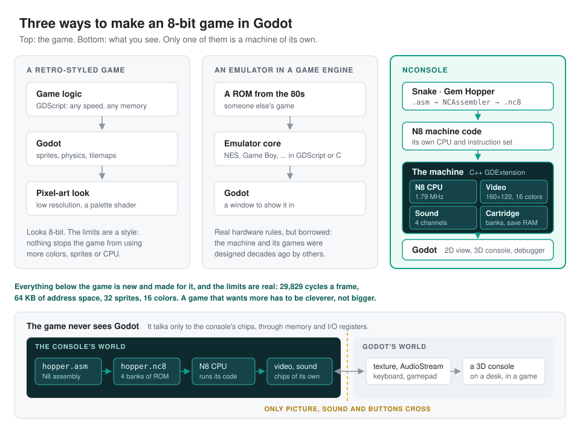

# NConsole


An 8-bit game console of our own, emulated inside Godot 4.7: the N8
processor, video with tiles, sprites and scrolling, a four-channel sound
chip, banked cartridges with save RAM, save states, an assembler, a
machine-code debugger, and a 3D model of the console that plays the games
on its screen. Three games come with it, written in N8 assembly: Snake,
Gem Hopper, a side-scroller, and Raycaster, a maze in first person.

The console itself is a GDExtension in C++; the tools and views around it
are GDScript. All the details are in [addons/nconsole/README.md](addons/nconsole/README.md).

It isn't a game made to look retro, nor an emulator of a console that
already exists: the machine, its instruction set and its games are all new,
and the games run on it under its real limits, without ever seeing Godot.



| Gem Hopper | Snake |
|---|---|
|  |  |

The debugger (F2): registers, the code at PC with your labels, and a
machine-code monitor, here stopped at a breakpoint in Gem Hopper.


## Using it in a project

Take `nconsole-<version>.zip` from the
[releases](https://github.com/uxerror/NConsole/releases) and unpack it into
the project: it holds `addons/nconsole/` with the native library built for
Linux, Windows and macOS. Then:

```gdscript
var console := NConsole.new()
console.insert(NCAssembler.load_cartridge("res://addons/nconsole/games/hopper.asm"))
console.set_pad(0, NConsole.BTN_RIGHT)
console.run_frame()                 # 1/60 s: picture in console.video.image, sound in console.sound
```

or put an `NConsoleScreen` (2D) or `NConsole3D` (the model) in a scene and
set its `cartridge_path`.

## Working on it

```sh
git clone --recursive https://github.com/uxerror/NConsole.git
cd NConsole/addons/nconsole/native
scons                                   # builds bin/ for this machine
cd ../../..
godot --headless --import
godot --headless --path . -s addons/nconsole/tests/run_tests.gd
godot --path .                          # the console on a table
```

## Contributing and the Use of AI Tools

We welcome both manually written pull requests and contributions made with the help of AI coding tools — NConsole itself was developed with their assistance. The requirements are the same as for any other code: you should understand exactly what you're changing and why, be able to explain your changes during code review, and make sure they work as intended. CI builds the extension for Linux, Windows and macOS and runs the tests on every pull request.

Disclosing the use of AI is entirely optional. I'm too lazy to check whether AI was used to create a pull request. I only disclose AI assistance in my own commits for the sake of transparency.
