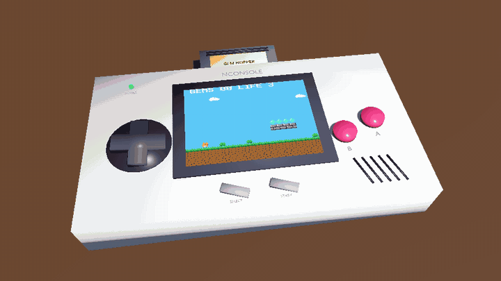
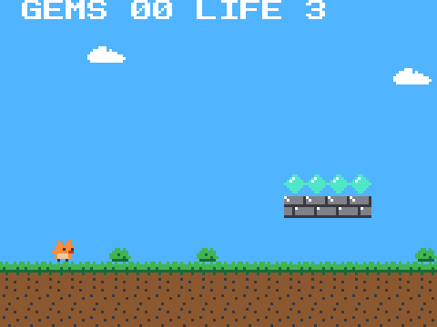
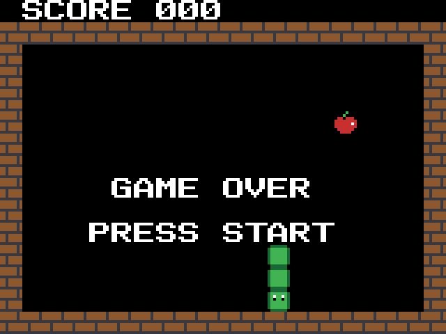
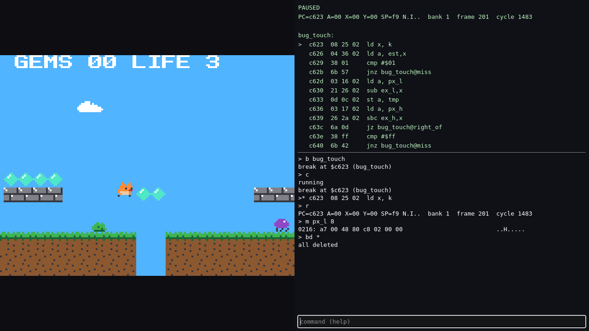

# NConsole



An 8-bit game console of our own, emulated inside Godot 4.7: the N8
processor, video with tiles, sprites and scrolling, a four-channel sound
chip, banked cartridges, an assembler, a machine-code debugger, and a 3D
model of the console that plays the games on its screen. Two games come
with it, written in N8 assembly: Snake and Gem Hopper, a side-scroller.

The console itself is a GDExtension in C++; the tools and views around it
are GDScript. All the details are in [addons/nconsole/README.md](addons/nconsole/README.md).

| Gem Hopper | Snake |
|---|---|
|  |  |

The debugger (F2): registers, the code at PC with your labels, and a
machine-code monitor, here stopped at a breakpoint in Gem Hopper.



## Using it in a project

Take `nconsole-<version>.zip` from the
[releases](https://github.com/uxerror/NConsole/releases) and unpack it into
the project: it holds `addons/nconsole/` with the native library built for
Linux, Windows and macOS. Then:

```gdscript
var console := NConsole.new()
console.insert(NCAssembler.load_cartridge("res://addons/nconsole/games/hopper.asm"))
console.set_pad(0, NConsole.BTN_RIGHT)
console.run_frame()                 # 1/60 s: picture in console.video.image, sound in console.sound
```

or put an `NConsoleScreen` (2D) or `NConsole3D` (the model) in a scene and
set its `cartridge_path`.

## Working on it

```sh
git clone --recursive https://github.com/uxerror/NConsole.git
cd NConsole/addons/nconsole/native
scons                                   # builds bin/ for this machine
cd ../../..
godot --headless --import
godot --headless --path . -s addons/nconsole/tests/run_tests.gd
godot --path .                          # the console on a table
```

## Continuous integration

`.github/workflows/ci.yml` builds the extension for Linux (x86_64),
Windows (x86_64) and macOS (universal), debug and release, and runs the
tests on Linux with Godot 4.7.2. Pushing a tag `v*` also publishes a
release with the addon ready to unpack.

## Contributing and the Use of AI Tools

We welcome both manually written pull requests and contributions made with the help of AI coding tools — NConsole itself was developed with their assistance. The requirements are the same as for any other code: you should understand exactly what you're changing and why, be able to explain your changes during code review, and make sure they work as intended.

Disclosing the use of AI is entirely optional. I'm too lazy to check whether AI was used to create a pull request. I only disclose AI assistance in my own commits for the sake of transparency.
